# Assignment 5 — AI-Assisted Sprint Health Report via Jira MCP

Part of the DevOps Micro Internship (DMI) Cohort 3 with Agentic AI

---

## Purpose

In this assignment, you will connect Claude Code to your Jira board through an MCP server, the same way you connected it to GitHub in Week 2, and build a read-only `/sprint-health` skill. The skill reads your current sprint through Jira's API and reports sprint velocity, stories at risk of missing the sprint, and items missing an estimate — but it must never create, edit, comment on, or transition a single ticket itself. You will prove that boundary holds by making a real change on the board yourself and confirming the skill only ever reports, never acts.

---

# Task 1 — Create a Jira API Token

## Goal

Generate an API token from your Atlassian account that the MCP server will use to authenticate with your Jira site. Do not screenshot the token value itself.

### Evidence

#### Screenshot 1 — Jira API token creation confirmation page showing the token name, with the token value not visible

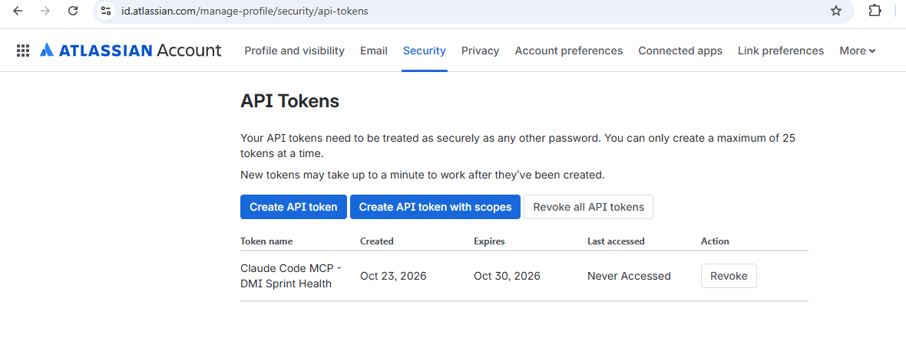

### Notes You Must Write (Very Important):

Why does the MCP server need your site URL and account email in addition to the token?

What is an API? 

API stands for Application Programming Interface. It is a defined set of rules that lets two separate pieces of software talk to each other. Instead of a human clicking buttons in Jira's web interface, an API lets a program (like Claude Code) send structured requests directly to Jira's servers and receive structured data back, without any browser or human interaction involved. 

Nearly every modern web service (GitHub, Jira, Slack, weather services, banks) exposes an API precisely so other software can integrate with it programmatically.

What is an API token used for? 

An API token is a credential that proves to Jira's API that  this request is really coming from an authorized user, without exposing your actual account password. It's scoped specifically for programmatic access, and — importantly — it can be individually named, tracked, and revoked at any time without affecting your main login. If this specific token were ever leaked, you could delete just this one token in Atlassian's settings, rather than having to change your entire account password.

What is MCP? 

MCP stands for Model Context Protocol — it's a standardized way for an AI assistant (like Claude) to connect to external tools and data sources (like Jira, GitHub, Slack, or a database) through a consistent, predictable interface. Instead of every AI tool needing custom, one-off integration code for every service it might connect to, MCP defines a common "language" that any compliant server can speak. 

An MCP server acts as a translator/bridge sitting between Claude and the actual external API (in this case, Jira's REST API) — Claude asks the MCP server for information using MCP's standard format, and the MCP server handles the actual authenticated API calls to Jira behind the scenes.

What does MCP do in this specific assignment?

The Jira MCP server (mcp-atlassian) is a program that knows how to speak both "MCP" (to Claude) and "Jira's actual API" (to Atlassian's servers). It uses the token, email, and site URL you're generating in this step to authenticate with Jira on Claude's behalf, then exposes specific, well-defined tools (like jira_search, jira_get_sprint) that Claude can call — always within whatever boundaries you configure (in this assignment, strictly read-only).

Why the MCP server needs the site URL + email, not just the token:

Jira's REST API authenticates using Basic Auth, which requires a username (your email) and a secret (the API token) together — the token alone doesn't identify which Atlassian account it belongs to or which Jira site to connect to, since Atlassian hosts many separate instances (your-site.atlassian.net is yours specifically, distinct from anyone else's). The token proves "this really is you," the email says "on behalf of this specific account," and the URL says "talk to this specific Jira instance, not some other one."

Why we do this step : 

Before Claude Code can read your Jira board at all, it needs a way to authenticate with Jira's API. This token is that credential , everything else in this assignment (the MCP server config, the skill) depends on this working correctly.

---

# Task 2 — Create .mcp.json at the Project Root

## Goal

Create or update `.mcp.json` at your project root with a Jira MCP server block, following the same shape as the GitHub MCP server you configured in Week 2.

### Evidence

#### Screenshot 2 — `.mcp.json` open in VS Code showing the Jira server configuration

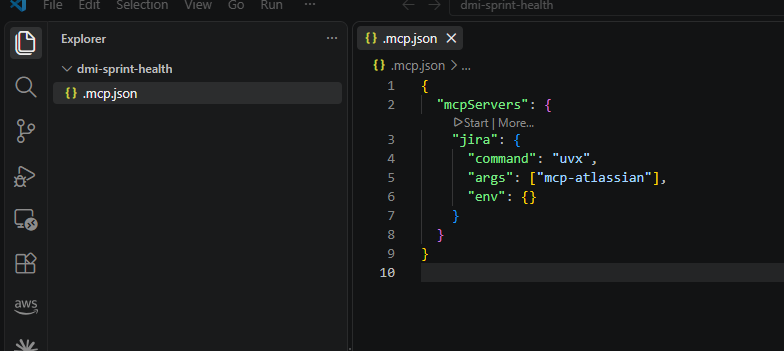

### Notes You Must Write (Very Important):

Compare this jira block to the github block from Week 2 Assignment 5. The GitHub server ran via npx (a Node.js package); this one runs via uvx (a Python package) — what stays exactly the same shape despite that difference, and why doesn't Claude Code care which language a given MCP server is written in?

What is .mcp.json?

The .mcp.json file tells Claude Code which MCP servers are available for the project and how to start them. Think of it as a configuration file that acts like a directory or registry for MCP servers.

When Claude Code starts, it reads this file and knows that it should launch a Jira MCP server.

Understanding the file

"jira"

This is the name of the MCP server. Claude Code uses this name to identify the Jira server.

"command": "uvx"

uvx is the program that starts the MCP server. It automatically downloads and runs the required Python package, so you don't have to install it manually.

"args": ["mcp-atlassian"]

This tells uvx which package to run. In this case, it runs mcp-atlassian, the Jira MCP server.

"env": {}

This section is for environment variables. It is left empty because sensitive information, such as your API token, email, and Jira URL, should be stored in a separate configuration file—not in .mcp.json.

Why do we create this file?

This file registers the Jira MCP server with Claude Code. Without it, Claude Code has no way of knowing that a Jira server exists or how to start it.

The actual login details (API token, email, and Jira URL) will be added later in a separate configuration file.

Expected Output

A .mcp.json file in the project's root directory containing the Jira MCP server configuration.

---

# Task 3 — Add Your Credentials to settings.local.json

## Goal

Add your Jira site URL, account email, and API token to `.claude/settings.local.json`, and confirm that file is listed in `.gitignore` so it is never committed.

### Evidence

#### Screenshot 3 — `settings.local.json` open in VS Code showing the `env` section, with the actual token value blurred or covered

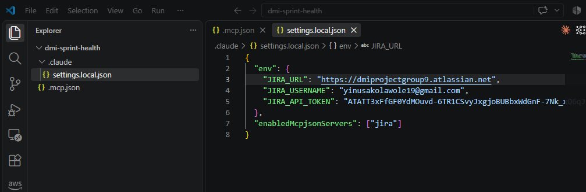

### Notes You Must Write (Very Important):

Why must JIRA_API_TOKEN live in settings.local.json and never in .mcp.json?

The .gitignore file tells Git which files or folders should not be tracked or committed to the repository.

Since settings.local.json contains sensitive information such as API tokens, usernames, and URLs, it should never be pushed to GitHub. By adding it to .gitignore, you protect your credentials while still allowing other project files to be committed safely.

Expected Output
.gitignore contains:   .claude/settings.local.json

---

# Task 4 — Verify the Connection with /mcp

## Goal

Restart Claude Code and confirm the Jira MCP server shows as connected.

### Evidence

#### Screenshot 4 — `/mcp` output showing `jira: connected`

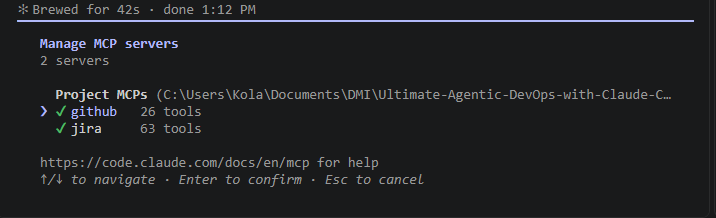

---

# Task 5 — Run a Live Query to Prove Real Board Data

## Goal

Ask Claude to list the issues in your current active sprint through the Jira MCP connection, and confirm the result matches what you see on your live board in the browser.

### Evidence

#### Screenshot 5 — Claude's response showing the live sprint issue list retrieved via Jira MCP

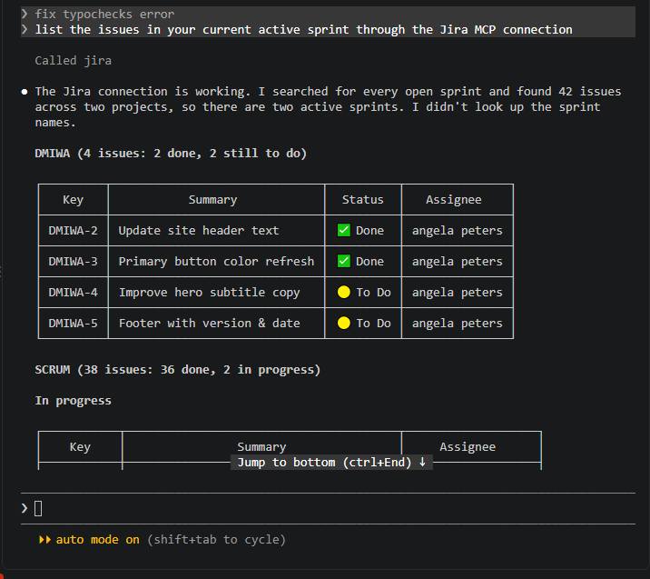

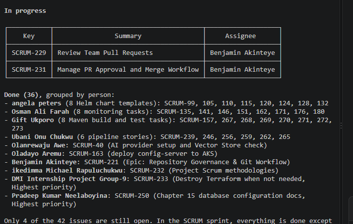

### Notes You Must Write (Very Important):

How did you confirm this was real board data and not something Claude guessed?

This task verifies that the Jira MCP server can successfully retrieve live data from the Jira project instead of generating or guessing information.

When the prompt is submitted, Claude sends the request to the Jira MCP server. The MCP server authenticates with Jira using the configured site URL, account email, and API token, then queries the Jira REST API for the active sprint. Jira returns the sprint data, and Claude formats it into a readable report.

The returned information includes the sprint details, all issues in the sprint, their status, assignees, story points, priorities, and an overall sprint summary.

Because the data is retrieved directly from Jira, the response reflects the current state of the project.

---

# Task 6 — Build the /sprint-health Skill

## Goal

Create a `/sprint-health` skill restricted to read-only Jira tools plus `Read`, with no issue-mutating tools and no `Write`. Run it and confirm it produces a report covering sprint velocity, at-risk stories, and items missing an estimate.

### Evidence

#### Screenshot 6 — `SKILL.md` frontmatter showing `allowed-tools` limited to read-only Jira tools plus `Read`, with `disable-model-invocation: true`

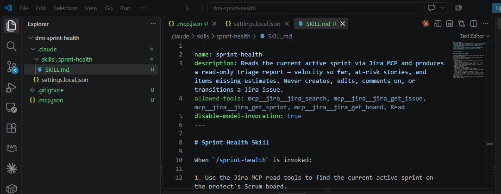

#### Screenshot 7 — `/sprint-health` output showing the full triage report against your real sprint

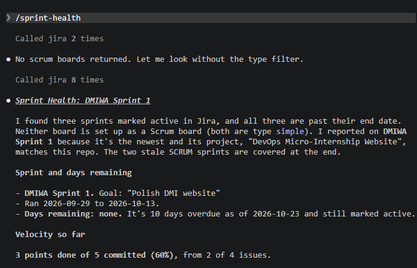

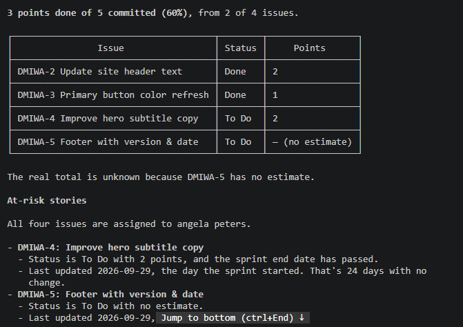

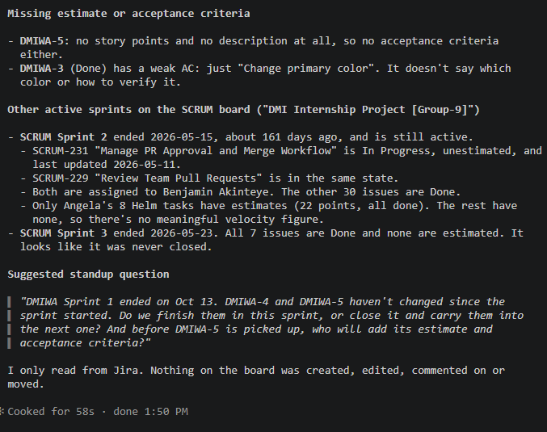

A Claude Code skill is a reusable prompt stored in the .claude/skills directory. Instead of writing the same prompt repeatedly, you can invoke the skill using a simple command such as:

/sprint-health
Claude automatically loads the instructions from SKILL.md and performs the requested workflow.

### Notes You Must Write (Very Important):

1. Which Jira MCP tools does this skill's allowed-tools list include, and which mutating tools (create issue, update issue, transition issue, add comment) does it deliberately exclude?

The allowed-tools field defines exactly which tools the skill is permitted to use.
In this skill, only Jira read tools are allowed:

mcp__jira__jira_search
mcp__jira__jira_get_issue
mcp__jira__jira_get_sprint
mcp__jira__jira_get_board
Read

These tools can retrieve information but cannot modify the Jira project.

Why disable-model-invocation: true?
This setting ensures the skill follows only the predefined workflow in SKILL.md rather than allowing additional model-driven reasoning or tool selection. It helps keep the skill predictable, focused, and restricted to the approved read-only operations defined in the skill.

Why this skill is read-only:

The skill is designed for sprint analysis, not project management.
It can:

Read sprint information
Retrieve issue details
Calculate sprint metrics
Identify risks
Generate reports

It cannot:

Create issues
Edit issues
Change issue status
Add comments
Delete issues
This protects the Jira board from unintended changes while still giving the Scrum Master valuable insights into the sprint.

2. Why does a Scrum Master need this restriction more than almost any other role in this course?

The skill is designed for sprint analysis, not project management.

It can:

Read sprint information
Retrieve issue details
Calculate sprint metrics
Identify risks
Generate reports

It cannot:

Create issues
Edit issues
Change issue status
Add comments
Delete issues
This protects the Jira board from unintended changes while still giving the Scrum Master valuable insights into the sprint.

---

# Task 7 — Prove the Skill Never Mutates the Board

## Goal

Manually update one ticket on your board in the browser (for example, move a story to "Done" or add a missing estimate), then run `/sprint-health` again and confirm the new report reflects your change — proving the skill only ever reads live state and never wrote to the board itself.

### Evidence

#### Screenshot 8 — Second `/sprint-health` run showing the report now reflects your manual board change

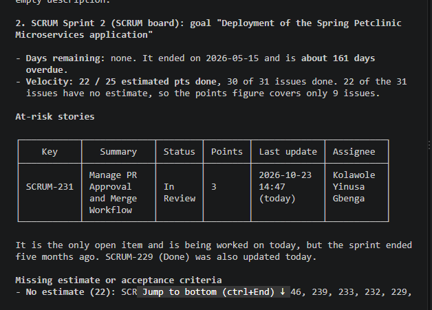

### Notes You Must Write (Very Important):

Map this assignment to Gather → Analyze → Human Act → Verify from Week 3 Assignment 6. Which step did you perform manually in the browser, and why must that step stay human?

I assigned Benjamin task to myself and added 3 points to it

I also changed the priority from medium to High

---

# Submission Instructions

Complete all tasks in sequence.

Your submission must include:
- All 8 required screenshots
- All the required notes

---

# Completion Checklist

- [ ] Task 1: Jira API token created, value never screenshotted (Screenshot 1)
- [ ] Task 2: `.mcp.json` has the Jira server block (Screenshot 2)
- [ ] Task 3: Credentials stored in `settings.local.json`, token blurred, file gitignored (Screenshot 3)
- [ ] Task 4: `/mcp` shows the Jira server connected (Screenshot 4)
- [ ] Task 5: Live query returned real sprint data, verified against the browser (Screenshot 5)
- [ ] Task 6: `/sprint-health` skill created with correct read-only `allowed-tools`, and produced a full report (Screenshots 6–7)
- [ ] Task 7: A manual board change was reflected in a second `/sprint-health` run (Screenshot 8)
- [ ] Skill never created, edited, transitioned, or commented on any issue
- [ ] Reflection answered (Notes)
- [ ] No API token value exposed

---

## 📌 About DMI & CloudAdvisory

DevOps Micro Internship (DMI) is a project-based DevOps program run by Pravin Mishra (The CloudAdvisory) focused on real-world execution, systems thinking, and career readiness.

It helps learners build strong DevOps foundations with hands-on experience.

---

## 📌 Resources

- 🌐 DMI Official Website: https://dmi.pravinmishra.com?utm_source=github&utm_medium=readme  
- 🎓 University: https://university.pravinmishra.com?utm_source=github&utm_medium=readme  
- 💬 Discord Community: https://discord.pravinmishra.com?utm_source=github&utm_medium=readme  
- 📝 Blog: https://dmi.pravinmishra.com/blog?utm_source=github&utm_medium=readme  
- ▶️ YouTube Playlist: https://www.youtube.com/playlist?list=PLFeSNDtI4Cho  
- 🔗 Pravin Mishra (LinkedIn): https://www.linkedin.com/in/pravin-mishra-aws-trainer/  
- 🏢 CloudAdvisory (LinkedIn): https://www.linkedin.com/company/thecloudadvisory/

---

*This submission is part of DevOps Micro Internship (DMI) Cohort 3 — Agentic AI Track.*
